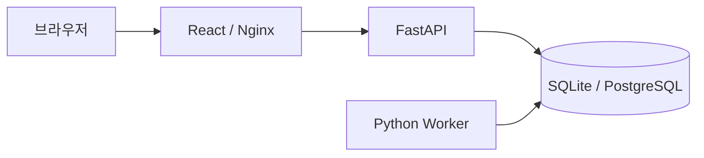

# BlendedMeshup

**Ubuntu 서버의 자산 정보와 공식 보안 자료를 연결하는 사이버 위협 인텔리전스 애플리케이션입니다.**

운영체제와 설치 패키지 정보를 기반으로 공개 취약점의 영향 여부를 분석하고, 판정 근거와 대응 정보를 웹 화면에서 제공하는 것을 목표로 합니다. 규칙 기반 판정과 RAG·LLM 기반 설명을 분리하여 결과의 출처와 분석 기준을 추적할 수 있도록 설계합니다.

## 현재 구현 상태

현재 버전은 **0.1.0 개발 버전**입니다. 자산 관리, 개발용 인증, 데이터베이스, 작업 큐, 기능별 API·화면 구조와 연결된 시험 예제가 구현되어 있습니다.

| 기능             | 상태   | 제공 범위                                                  |
| ---------------- | ------ | ---------------------------------------------------------- |
| 자산 관리        | 구현   | 등록, 목록·상세 조회, 활성·비활성 변경                     |
| 작업 관리        | 구현   | 연결 확인 작업 접수, Worker 처리, 상태·오류 조회           |
| 공통 API         | 구현   | 개발 토큰 인증, 입력 검증, 오류 응답, 상태 확인, OpenAPI   |
| 웹 애플리케이션  | 구현   | 자산·작업 화면, 페이지 이동, 공통 연결·오류 처리           |
| 개발용 시험 예제 | 구현   | 가상 인벤토리·보안 자료·기대 판정·인용을 연결한 API와 화면 |
| 서버 환경 수집   | 미구현 | 수집 인터페이스와 API 경로 정의                            |
| 공식 보안 자료   | 미구현 | 정규화 계약·수집 인터페이스와 갱신 API 경로 정의           |
| 취약점 판정      | 미구현 | 데이터 계약, 판정 인터페이스, API·화면 구조 정의           |
| 질의응답·보고서  | 미구현 | 검색·LLM 인터페이스, API·화면 구조 정의                    |

미구현 API는 인증·입력 검증 후 `501 FEATURE_NOT_IMPLEMENTED`를 반환합니다. 현재 자산 주소를 등록해도 SSH 연결이나 취약점 분석은 실행되지 않습니다. 구현 범위와 검증 결과는 [기능 명세](docs/specification.md)와 [검증 기록](docs/verification.md)에 설명되어 있습니다.

## 기술 구성

| 구분                   | 구성                                               |
| ---------------------- | -------------------------------------------------- |
| 백엔드                 | Python 3.12, FastAPI, Pydantic                     |
| 데이터 계층            | SQLAlchemy, Alembic                                |
| 프론트엔드             | React, TypeScript 5.9, Vite, Node.js 24            |
| 통합 실행 데이터베이스 | PostgreSQL 17, pgvector 확장                       |
| 로컬 개발 데이터베이스 | SQLite                                             |
| 작업 처리              | 데이터베이스 큐와 단일 Python Worker               |
| 실행 구성              | Docker Compose, Nginx                              |
| 품질 검사              | Ruff, pytest, Prettier, TypeScript, GitHub Actions |

pgvector는 확장 설치만 구성되어 있으며, 벡터 테이블과 검색 기능은 아직 구현되지 않았습니다. Python과 JavaScript 의존성은 각각 `uv.lock`, `frontend/package-lock.json`으로 관리합니다.

## 시스템 구성



Docker Compose는 `db`, `migrate`, `api`, `worker`, `web` 서비스를 실행합니다. 로컬 개발에서는 Nginx 대신 Vite 개발 서버를 사용하며 기본 저장소는 SQLite입니다. 수집·판정·검색·LLM·보고서는 백엔드의 독립 모듈로 확장하도록 구성되어 있습니다.

## 실행 방법

### 로컬 개발 (기본 경로)

필요 환경: Python 3.10 이상, uv, Node.js 24와 npm. 애플리케이션용 Python 3.12는 uv가 준비합니다. 로컬 기본 DB는 SQLite이며 외부 서버·GPU가 필요하지 않습니다.

저장소 루트에서 실행합니다.

```bash
make dev
```

Make를 사용하지 않는 환경에서는 같은 실행기를 직접 호출합니다.

```bash
python3 scripts/dev.py
```

실행기는 런타임·포트·설정을 검사하고, 환경 파일 생성·의존성 설치·마이그레이션을 거쳐 API·Worker·웹을 실행합니다. 처음 실행하거나 잠금 파일이 바뀌면 의존성을 설치합니다. 터미널에서 **Ctrl+C**를 누르면 실행기가 시작한 프로세스를 함께 종료합니다. 같은 저장소에서 두 번째 실행기를 시작하면 중복 실행을 차단합니다.

1. [로컬 웹](http://localhost:5173)을 엽니다.
2. `.env`의 `DEV_API_TOKEN`을 입력합니다.
3. 자산 등록, **작업 내역 → Worker 연결 확인**, **시험 예제**를 확인합니다.

화면 작업과 시험 예제만 실행할 때는 Worker를 생략할 수 있습니다.

```bash
make dev-ui
# 동일한 실행: python3 scripts/dev.py --no-worker
```

이 모드에서 접수한 Worker 작업은 Worker를 실행할 때까지 대기합니다. 개발 토큰은 브라우저 메모리에 유지되므로 새로고침 후 다시 입력합니다. 데이터는 `.data/dev.db`에 저장됩니다.

포트를 변경하거나 서버 실행 없이 준비만 수행할 수도 있습니다.

```bash
python3 scripts/dev.py --api-port 8001 --web-port 5174
python3 scripts/dev.py --prepare-only
```

API 포트를 변경하면 웹 프록시도 함께 변경됩니다. 환경 변수와 저장소 차이는 [설정 안내](docs/configuration.md)를 참고합니다.

### 시험 예제

**시험 예제** 화면은 가상 패키지 두 개, 가상 CVE 한 개, 정규화된 공지와 고정된 기대 결과를 표시합니다. 입력·패키지 참조·규칙·근거·설명이 서로 연결되는지 확인할 수 있습니다. 실제 버전 비교나 취약점 판정, LLM 생성은 수행하지 않습니다.

API·DB·Worker 없이 예제 데이터만 검사하려면 다음 명령을 사용합니다.

```bash
make example
# 전체 JSON: uv run python -m backend.examples --json
```

예제 파일, API와 작은 변경을 확인하는 방법은 [시험 예제 안내](docs/development-example.md)에 설명되어 있습니다.

### Docker Compose (통합 실행)

필요 환경: Docker Engine 또는 Docker Desktop, Compose v2, Python 3.10 이상. Compose 구성과 CI 검증 작업이 제공되며 현재 로컬 환경의 전체 기동은 미검증입니다.

```bash
python3 scripts/init_env.py
docker compose up --build -d --wait
```

[통합 웹](http://localhost:8080)에서 `.env`의 개발 토큰을 입력합니다. [API 문서](http://localhost:8080/api/docs)의 **Authorize**에서도 같은 토큰을 사용합니다.

```bash
docker compose logs -f api worker
docker compose down
```

일반 `down`은 DB 볼륨을 보존합니다. 웹 포트는 기본적으로 `127.0.0.1:8080`에 바인딩됩니다. 현재는 `APP_ENV=development`만 지원하며 사용자 계정·권한·세션 인증은 구현되지 않았습니다.

## 디렉터리 구조

```text
backend/
  api/              # HTTP 라우터, 요청·응답 스키마, 인증 의존성
  core/             # 설정, 데이터베이스 연결, 공통 오류
  models/           # 저장 모델, 도메인 계약, 상태 코드
  migrations/       # Alembic 데이터베이스 변경 이력
  worker/           # 작업 큐 조회 및 처리
  collectors/       # 서버 환경·공식 자료 수집 확장 모듈
  normalizers/      # 보안 자료 정규화 인터페이스
  assessment/       # 규칙 기반 판정 인터페이스
  retrieval/        # 근거 검색 인터페이스
  llm/              # 설명 생성 인터페이스
  reports/          # 보고서 확장 모듈
  examples/         # 연결된 시험 자료·검증·CLI
frontend/src/
  app/              # 탐색, 공통 레이아웃, 개발 세션
  api/              # HTTP 클라이언트, OpenAPI 생성 타입
  features/         # 자산, 작업, 취약점, 질의응답, 보고서, 시험 예제
  shared/           # 공통 컴포넌트, 훅, 표시 형식
tests/              # 단위·통합 테스트, 시험 자료, 인수 시험 명세
infra/              # Dockerfile, Nginx 설정
scripts/            # 개발 실행, 환경 초기화, API 명세 생성, HTTP 검증
docs/               # 기능 명세, 아키텍처, 설정, API, 검증 문서
```

## 문서

- [문서 목록](docs/README.md)
- [기능 명세](docs/specification.md)
- [시스템 아키텍처](docs/architecture.md)
- [API 및 데이터 계약](docs/api-contracts.md)
- [설정 안내](docs/configuration.md)
- [시험 예제 안내](docs/development-example.md)
- [개발 가이드](CONTRIBUTING.md)
- [개발 예정 기능](docs/roadmap.md)
- [검증 기록](docs/verification.md)
