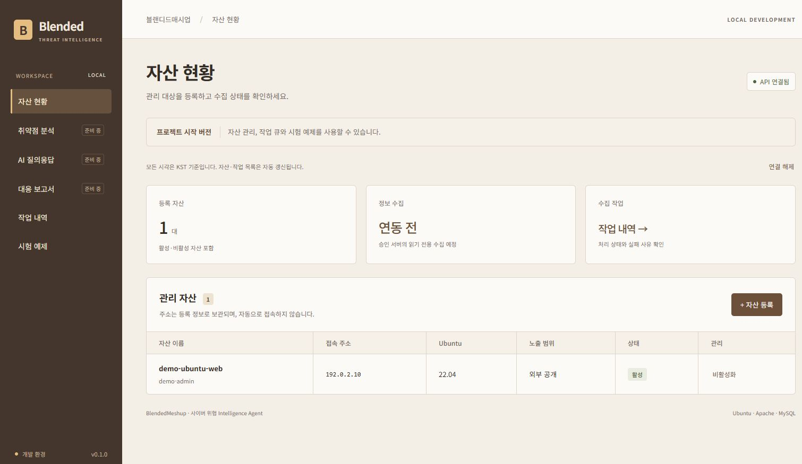
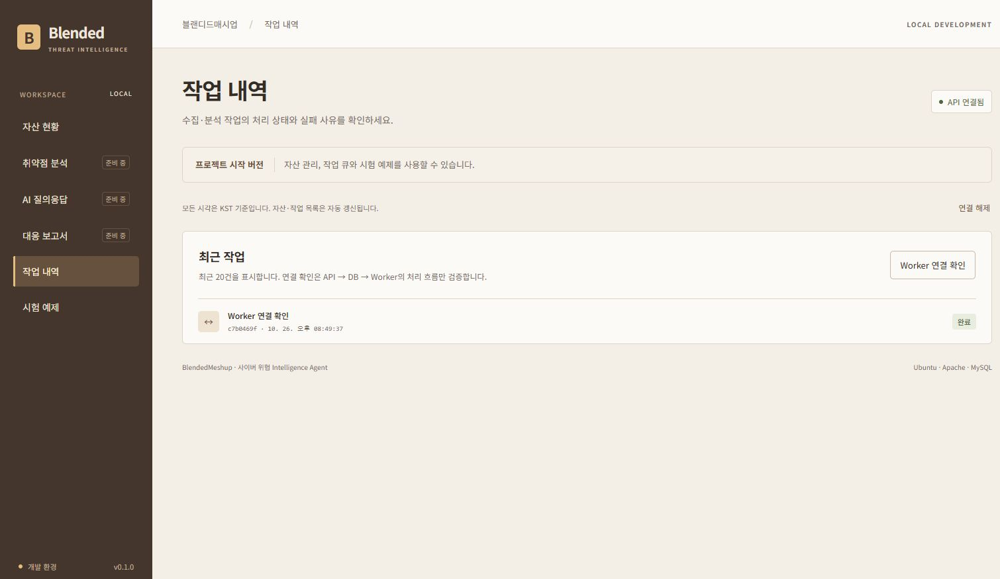
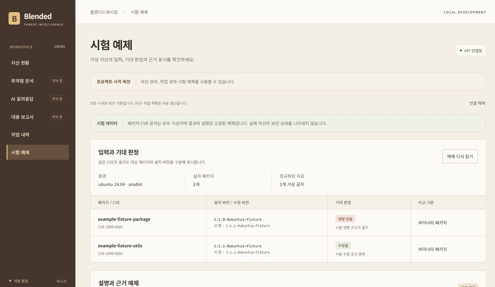
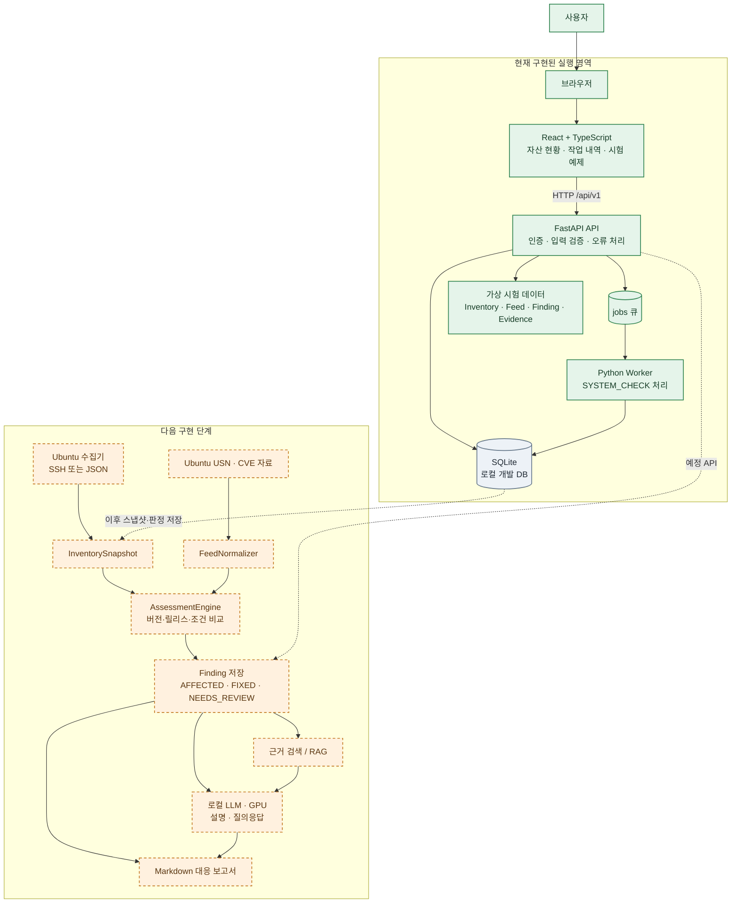
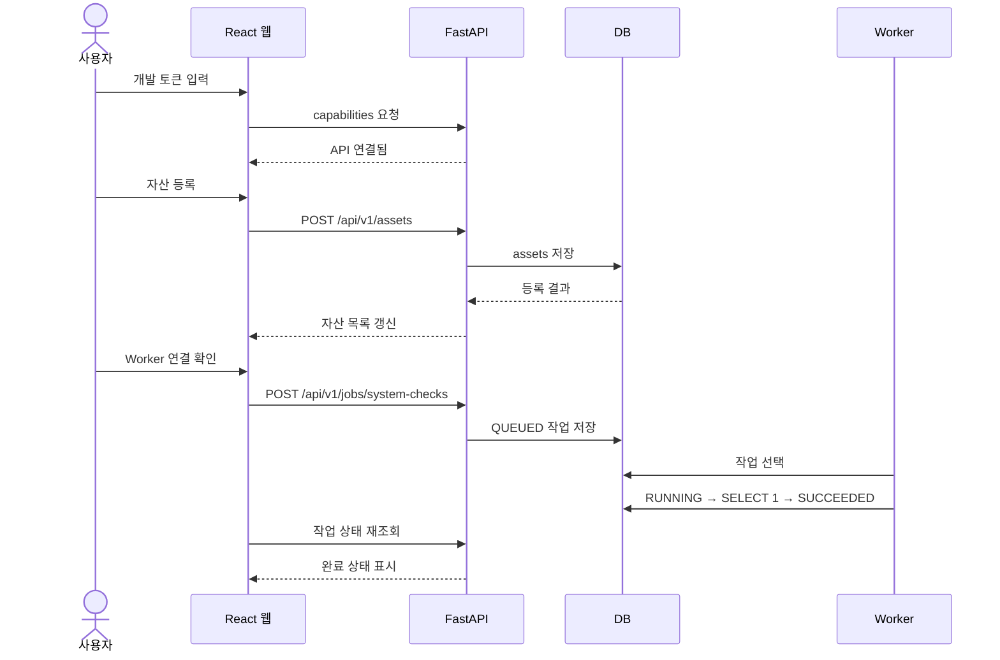
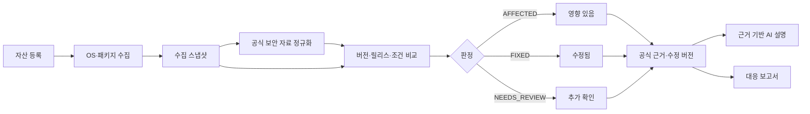

# BlendedMeshup

Ubuntu 서버의 설치 패키지 상태와 공식 보안 자료를 연결해 취약점 영향 여부와 대응 근거를 보여주는 사이버 위협 인텔리전스 프로젝트입니다.

현재 버전은 **0.1.0 개발 버전**입니다. 웹 화면, FastAPI, 데이터베이스, 작업 Worker를 연결한 실행 기반과 가상 보안 자료를 이용한 시험 예제를 구현했습니다. 실제 Ubuntu 서버 수집과 공식 CVE 판정은 다음 단계에서 연결할 예정입니다.

| 한눈에 보기 | 현재 내용 |
| --- | --- |
| 현재 데모 | 자산 등록 → DB 저장 → Worker 작업 처리 → 시험용 CVE·근거 표시 |
| 실제 구현 | React, FastAPI, SQLite/PostgreSQL, DB 기반 Worker |
| 현재 제한 | 실제 SSH 수집·CVE 판정·RAG·LLM·보고서는 아직 연결 전 |
| 다음 목표 | Ubuntu 패키지 수집 → 규칙 기반 판정 → 근거 표시 → GPU 기반 설명 |

## 현재 웹 화면

아래 이미지는 현재 구현된 웹을 로컬에서 실행하고 시연용 데이터를 입력한 뒤 캡처한 화면입니다.

### 자산 등록

자산 이름, 주소, 예상 Ubuntu 릴리스, 노출 범위와 담당자를 등록하고 목록에서 활성 상태를 확인할 수 있습니다. 현재 주소는 등록 정보로만 저장되며 자동 접속하지 않습니다.



### 작업 큐와 Worker

`Worker 연결 확인`을 누르면 작업이 큐에 등록되고 별도 Worker가 작업을 가져가 처리합니다.



### 시험용 CVE·판정·근거 예제

가상 Ubuntu 패키지와 가상 CVE를 이용해 설치 버전, 수정 버전, 기대 판정, 비교 기준과 근거가 연결되는 모습을 확인합니다. 이 결과는 실제 서버 분석 결과가 아니라 계약과 화면 흐름을 검증하기 위한 고정 예제입니다.



## 구현 현황

| 영역 | 상태 | 현재 제공 범위 |
| --- | --- | --- |
| 웹 애플리케이션 | 구현 | React 화면, 메뉴 이동, API 연결 상태, 오류·성공 알림 |
| 자산 관리 | 구현 | 등록·목록 조회·상세 조회·활성/비활성 변경 |
| 작업 큐 | 구현 | `SYSTEM_CHECK` 접수, DB 큐 저장, Worker 처리, 상태 조회 |
| 공통 API | 구현 | FastAPI, 개발 토큰 인증, 입력 검증, 요청 ID, 공통 오류 응답 |
| 데이터 저장 | 구현 | SQLite, PostgreSQL Compose 구성, Alembic 마이그레이션 |
| 시험 예제 | 구현 | 가상 인벤토리·보안 자료·판정·인용 참조 검증 |
| 서버 환경 수집 | 설계 단계 | `InventoryCollector` 인터페이스만 정의 |
| 공식 보안 자료 | 설계 단계 | `FeedNormalizer` 인터페이스만 정의 |
| 취약점 판정 | 설계 단계 | `AssessmentEngine`과 판정 계약만 정의 |
| 근거 검색·AI 설명 | 설계 단계 | `Retriever`, `ExplanationProvider`만 정의 |
| 질의응답·보고서 | 화면/API 틀 | 현재 `501 FEATURE_NOT_IMPLEMENTED` 반환 |

현재 자산 주소를 등록해도 SSH 접속이나 실제 취약점 분석은 실행되지 않습니다. 시험 예제의 CVE, 패키지, 공지와 URL은 모두 가상 데이터입니다.

## 시스템 구성

아래 그림은 현재 실행되는 부분과 앞으로 연결할 보안 분석 파이프라인을 한 장에 보여줍니다. 초록색은 현재 동작하는 구성, 주황색은 인터페이스와 화면만 준비된 확장 영역입니다.



### 현재 동작 흐름



현재 Worker가 처리하는 작업은 API·DB·Worker 연결을 확인하는 `SYSTEM_CHECK` 하나입니다. 시험 예제 화면은 외부 서버나 모델을 호출하지 않고, 패키지·CVE·판정·근거가 서로 연결되는지 검증합니다.

### 최종 목표 처리 흐름



판정은 규칙 기반으로 처리해 결과를 재현하고, GPU는 판정 결과와 공식 근거를 바탕으로 AI 설명·질의응답을 생성하는 데 사용할 계획입니다.

## 기술 구성

| 구분 | 사용 기술 |
| --- | --- |
| 백엔드 | Python 3.12, FastAPI, Pydantic |
| 데이터 계층 | SQLAlchemy 2, Alembic |
| 프론트엔드 | React 19, TypeScript, Vite |
| 로컬 DB | SQLite |
| 통합 DB | PostgreSQL 17 + pgvector 확장 |
| 작업 처리 | DB 기반 큐 + 단일 Python Worker |
| 통합 실행 | Docker Compose, Nginx |
| 품질 검사 | Ruff, pytest, TypeScript, Prettier |

`pgvector` 확장은 구성되어 있지만 현재 벡터 테이블과 실제 RAG 검색은 구현되지 않았습니다.

## 디렉터리 구조

```text
backend/
├─ api/
│  ├─ main.py                 # FastAPI 앱, 라우터, 공통 오류 처리
│  ├─ dependencies.py         # DB 세션과 개발용 토큰 인증
│  ├─ routes/                 # assets, jobs, examples 및 기능 API
│  └─ schemas/                # HTTP 요청·응답 검증 모델
├─ core/
│  ├─ config.py               # 환경 변수와 실행 설정
│  ├─ database.py             # SQLite/PostgreSQL 엔진과 세션
│  ├─ errors.py               # 공통 애플리케이션 오류
│  └─ diagnostics.py          # 안전한 오류 위치 기록
├─ models/
│  ├─ tables.py               # 현재 DB 테이블: assets, jobs
│  ├─ enums.py                # 상태·판정·수집 방식 열거형
│  └─ contracts.py            # 인벤토리·자료·판정·답변 계약
├─ migrations/                # Alembic 스키마 변경 이력
├─ worker/runner.py           # 큐 조회, 상태 전이와 작업 실행
├─ collectors/                # 서버 정보 수집 확장 위치
├─ normalizers/               # 보안 자료 정규화 확장 위치
├─ assessment/                # 취약점 판정 엔진 확장 위치
├─ retrieval/                 # 근거 문서 검색 확장 위치
├─ llm/                       # 설명 생성 모델 연결 확장 위치
├─ reports/                   # 보고서 생성 확장 위치
└─ examples/
   ├─ assessment.py           # 가상 데이터 적재와 참조 검증
   └─ data/                   # inventory, feed, expected JSON

frontend/src/
├─ App.tsx                    # 세션·레이아웃·페이지 조합
├─ app/                       # 메뉴, 해시 라우팅, 세션, 레이아웃
├─ api/                       # HTTP 클라이언트와 생성 타입
├─ features/
│  ├─ assets/                 # 자산 등록·목록
│  ├─ jobs/                   # 작업 큐
│  ├─ examples/               # 시험 예제
│  ├─ findings/               # 판정 화면 틀
│  ├─ questions/              # 질의응답 화면 틀
│  └─ reports/                # 보고서 화면 틀
└─ shared/                    # 공통 컴포넌트와 폴링 훅

infra/                        # Dockerfile, Nginx 프록시
scripts/                      # 실행·환경 초기화·OpenAPI·HTTP 검사
tests/                        # 단위·통합·프론트엔드 시험
docs/                         # 명세, 검증 기록과 화면 캡처
```

## 실행 방법

### 로컬 개발

필요 환경은 Python 3.12, `uv`, Node.js 24, npm입니다.

```bash
python scripts/init_env.py
make dev
```

실행 후 [http://localhost:5173](http://localhost:5173)을 열고 `.env`의 `DEV_API_TOKEN`을 입력합니다. 실행기는 설정, DB 마이그레이션, FastAPI, Worker, Vite를 한 번에 시작합니다.

Worker 없이 화면만 확인하려면 다음을 사용합니다.

```bash
make dev-ui
```

이 경우 작업은 Worker를 다시 실행할 때까지 `QUEUED` 상태로 남습니다.

### 시험 예제만 확인

```bash
make example
uv run python -m backend.examples --json
```

시험 예제는 DB, 외부 서버, 인터넷, GPU를 사용하지 않습니다.

### Docker Compose

```bash
python scripts/init_env.py
docker compose up --build -d --wait
```

통합 웹은 [http://127.0.0.1:8080](http://127.0.0.1:8080), API 문서는 [http://127.0.0.1:8080/api/docs](http://127.0.0.1:8080/api/docs)에서 확인합니다.

```bash
docker compose logs -f api worker
docker compose down
```

현재 Compose 구성은 개발 환경용입니다.

## 주요 API

인증이 필요한 경로는 다음 헤더를 사용합니다.

```http
Authorization: Bearer <DEV_API_TOKEN>
```

| 메서드 | 경로 | 설명 |
| --- | --- | --- |
| GET | `/api/v1/health` | 프로세스 응답 확인 |
| GET | `/api/v1/readiness` | DB·마이그레이션·테이블 확인 |
| GET | `/api/v1/capabilities` | 기능 플래그 조회 |
| GET | `/api/v1/assets` | 자산 목록 조회 |
| POST | `/api/v1/assets` | 자산 등록 |
| PATCH | `/api/v1/assets/{asset_id}` | 활성 상태 변경 |
| GET | `/api/v1/jobs` | 작업 목록 조회 |
| POST | `/api/v1/jobs/system-checks` | 연결 확인 작업 접수 |
| GET | `/api/v1/jobs/{job_id}` | 작업 상태 조회 |
| GET | `/api/v1/examples/assessment` | 가상 시험 예제 조회 |

분석·수집·질의응답·보고서 경로는 현재 구조만 정의되어 있으며 `501 FEATURE_NOT_IMPLEMENTED`를 반환합니다.

## 시연 순서

```text
1. 개발용 토큰으로 웹 연결
2. Ubuntu 시험 자산 등록
3. Worker 연결 확인 실행
4. QUEUED → RUNNING → SUCCEEDED 상태 확인
5. 시험 예제에서 패키지별 기대 판정 확인
6. 설치 버전·수정 버전·비교 기준·근거 확인
7. 실제 수집·판정·AI·보고서는 다음 단계라고 설명
```

시험 예제는 반드시 가상 데이터라고 설명합니다. 실제 보안 상태나 실제 CVE 정확도를 의미하지 않습니다.

## 다음 구현 순서

1. Ubuntu 22.04 또는 24.04와 Apache2 또는 MySQL 한 제품을 우선 지원
2. SSH 또는 JSON 입력에서 OS·패키지·전체 버전 수집
3. Ubuntu 공식 보안 자료를 `FeedSnapshot`으로 정규화
4. Debian 버전 규칙을 적용한 판정 엔진 구현
5. 판정 결과와 공식 근거를 DB·화면에 연결
6. 근거가 제공된 결과만 설명하도록 질의응답 연결
7. 분석 기준본과 인용을 포함한 Markdown 보고서 생성

## 테스트

```bash
uv run ruff check backend scripts tests
uv run ruff format --check backend scripts tests
uv run pytest
npm --prefix frontend run format:check
npm --prefix frontend test
npm --prefix frontend run build
```

## 관련 문서

- [시스템 아키텍처](docs/architecture.md)
- [기능 명세](docs/specification.md)
- [API 및 데이터 계약](docs/api-contracts.md)
- [시험 예제 안내](docs/development-example.md)
- [설정 안내](docs/configuration.md)
- [개발 예정 기능](docs/roadmap.md)
- [검증 기록](docs/verification.md)
- [프론트엔드 안내](frontend/README.md)

## 주의 사항

- 현재 버전은 개발 환경만 지원합니다.
- 개발용 공통 토큰은 사용자 계정·권한을 구분하지 않습니다.
- 자산 주소 등록은 실제 SSH 접속이나 명령 실행으로 이어지지 않습니다.
- 시험 예제의 패키지·CVE·공지·URL은 가상 데이터입니다.
- 현재 벡터 검색, LLM 호출, 실제 CVE 판정, 보고서 생성은 구현되지 않았습니다.
