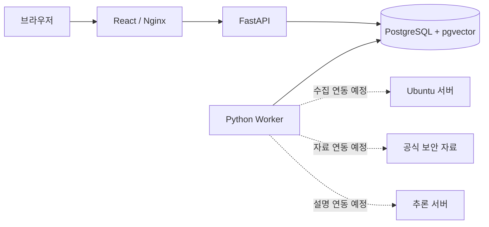
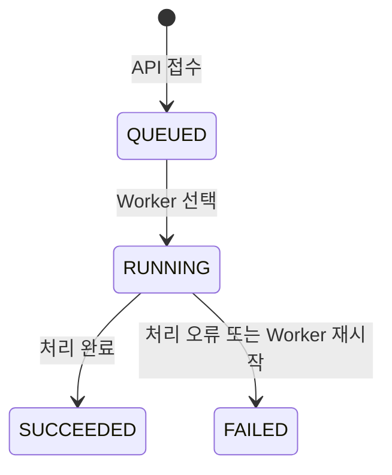

# 시스템 아키텍처

## 실행 구성

애플리케이션은 웹 클라이언트, HTTP API, 데이터베이스, 단일 Worker로 구성됩니다. API와 Worker는 같은 Python 패키지와 데이터 모델을 사용하며 작업 상태를 데이터베이스를 통해 교환합니다.

점선은 미구현 연동입니다. 현재 Worker가 실행하는 작업은 데이터베이스 연결을 확인하는 `SYSTEM_CHECK` 한 종류입니다.

| 서비스    | 역할                                | 시작 조건         |
| --------- | ----------------------------------- | ----------------- |
| `db`      | PostgreSQL 저장소                   | 선행 서비스 없음  |
| `migrate` | Alembic 변경 이력 적용 후 종료      | `db` 준비 완료    |
| `api`     | 자산·작업 API와 공통 인증·오류 처리 | 마이그레이션 성공 |
| `worker`  | 큐 조회 및 작업 실행                | 마이그레이션 성공 |
| `web`     | 정적 웹 제공, `/api` 프록시         | API 준비 완료     |

Compose는 웹 포트만 호스트의 루프백 주소에 공개합니다. API와 데이터베이스는 컨테이너 내부 네트워크에서 통신합니다. 로컬 개발에서는 `scripts/dev.py`가 API·Worker·Vite 프로세스를 함께 관리하고 SQLite를 사용합니다. `--no-worker`로 Worker를 생략할 수 있습니다. 종료 시 실행기가 시작한 하위 프로세스도 정리합니다.

## 백엔드 모듈

| 경로                          | 기능                                           | 현재 상태                          |
| ----------------------------- | ---------------------------------------------- | ---------------------------------- |
| `backend/api/routes/`         | 자산, 작업, 자료, 판정, 질의, 보고서 HTTP 경로 | 자산·작업 구현, 나머지 미구현 응답 |
| `backend/api/schemas/`        | 기능별 요청·응답 검증                          | 구현                               |
| `backend/core/`               | 환경 설정, DB 연결, 공통 오류                  | 구현                               |
| `backend/models/tables.py`    | 영속 데이터 모델                               | `assets`, `jobs` 구현              |
| `backend/models/contracts.py` | 수집·판정·근거·답변의 도메인 계약              | 초기 계약 구현                     |
| `backend/migrations/`         | 데이터베이스 변경 이력                         | `0001` 구현                        |
| `backend/worker/`             | 큐 조회, 작업 상태 전이, 중단 작업 처리        | 연결 확인 작업 구현                |
| `backend/collectors/`         | 읽기 전용 서버 수집과 공식 자료 수집           | 인터페이스·확장 위치               |
| `backend/normalizers/`        | 원문·CVE·수정 정보 정규화                      | 입력·출력 인터페이스               |
| `backend/assessment/`         | 환경과 공식 조건의 결정적 대조                 | 인터페이스                         |
| `backend/retrieval/`          | 분석 기준에 연결된 근거 검색                   | 인터페이스                         |
| `backend/llm/`                | 구조화된 결과에 대한 설명 생성                 | 인터페이스                         |
| `backend/examples/`           | 연결된 시험 입력·고정 기대 결과·CLI            | 구현; 실제 분석과 구분             |
| `backend/reports/`            | 판정·근거를 묶은 보고서 생성                   | 확장 위치                          |

수집, 판정, 검색, 설명 생성 인터페이스는 `Protocol`로 정의되어 있습니다. 인터페이스 선언은 실행 가능한 구현체나 외부 서비스 연결을 의미하지 않습니다.

## 프론트엔드 구성

`app/`은 탐색·레이아웃·개발 세션을 관리하고, `features/`는 기능별 화면과 API 호출을 포함합니다. `shared/`는 공통 컴포넌트·조회 훅·시각 표시를 제공합니다.

화면 경로는 `#/assets`, `#/findings`, `#/questions`, `#/reports`, `#/jobs`, `#/example`입니다. 해시 경로를 사용하므로 새로고침 시 경로를 유지하며 브라우저 탐색을 지원합니다. 정의되지 않은 경로는 자산 화면으로 표시합니다.

연결 확인은 `/api/v1/capabilities`를 사용합니다. 인증 성공 후 생성한 HTTP 클라이언트와 토큰은 메모리에 유지합니다. 자산·작업 조회는 요청 완료 후 5초 뒤 갱신하며 화면 해제 시 진행 중인 요청을 취소합니다. 미구현 페이지는 기능 상태와 예정 표시 항목을 안내합니다. 시험 예제 화면은 인증된 읽기 전용 예제 API를 사용하며 가상 입력·기대 판정·인용을 표시합니다. 이 자료는 패키지 JSON 파일로 읽고 데이터베이스에 적재하지 않습니다.

## 데이터 저장

| 테이블   | 저장 내용                                                                                  |
| -------- | ------------------------------------------------------------------------------------------ |
| `assets` | 자산 ID·이름, 주소, 예상 릴리스, 공개 범위, 중요도, 관리 표시명, 활성 상태, 생성·수정 시각 |
| `jobs`   | 작업 ID·유형, 자산 참조, 상태, 중복 방지 키, 시도 횟수, 결과·오류, 시작·종료 시각          |

자산 이름과 작업의 중복 방지 키에는 고유 제약이 적용됩니다. 작업 상태에는 조회 인덱스가 있습니다. PostgreSQL에서는 초기 마이그레이션이 `vector` 확장을 생성하지만 현재 벡터 컬럼이나 검색 인덱스는 없습니다.

시각은 UTC 기준으로 기록하고 API에서 시간대 정보를 포함해 반환합니다. 화면은 KST로 표시합니다. SQLite 파일과 Compose의 PostgreSQL 볼륨은 별도 저장소이며 자동 동기화되지 않습니다.

## 작업 처리

1. API는 `Idempotency-Key`로 기존 작업을 조회하고, 동일한 키가 없으면 `QUEUED` 작업을 생성합니다.
2. Worker는 생성 순서대로 작업을 선택하고 `RUNNING`으로 변경합니다.
3. `SYSTEM_CHECK`는 데이터베이스에 `SELECT 1`을 실행한 뒤 결과와 종료 시각을 기록합니다.
4. 지원하지 않는 작업 유형은 `UNSUPPORTED_JOB_TYPE`, 실행 오류는 `JOB_EXECUTION_FAILED`로 실패 처리합니다.

PostgreSQL에서는 세션 advisory lock으로 두 번째 Worker의 실행을 차단합니다. SQLite에는 같은 잠금이 없으므로 한 Worker만 실행해야 합니다. Worker 시작 시 남아 있는 `RUNNING` 작업은 `WORKER_RESTARTED`로 실패 처리합니다.

`PARTIAL`은 상태 열거형에 정의되어 있지만 현재 연결 확인 작업에서는 생성되지 않습니다. 자동 재시도, 취소, 예약 실행, 작업별 시간 제한과 heartbeat는 미구현입니다.

## 확장 설계

향후 저장 구조는 자산 스냅샷, 설치 패키지, 공식 문서 버전, 분석 실행, 판정, 문서 조각, 답변·보고서로 확장합니다. 이 항목들은 현재 데이터베이스에 생성되지 않습니다.

분석 결과는 수집 스냅샷·보안 자료 버전·규칙 버전에 연결하고, 설명과 보고서는 같은 분석 기준을 참조하도록 설계합니다. 모델 추론 실패가 저장된 판정과 근거 조회를 중단하지 않도록 처리 경로를 분리합니다.

현재 인증은 개발용 공통 토큰이며 운영용 계정·권한·세션은 없습니다. 외부 I/O 기능에는 별도의 접속 프로필, 허용 대상 검증, 호스트 키 검증, 요청 제한, 시간 제한이 필요합니다. 상세 요구사항은 [기능 명세](specification.md)에 정의합니다.
