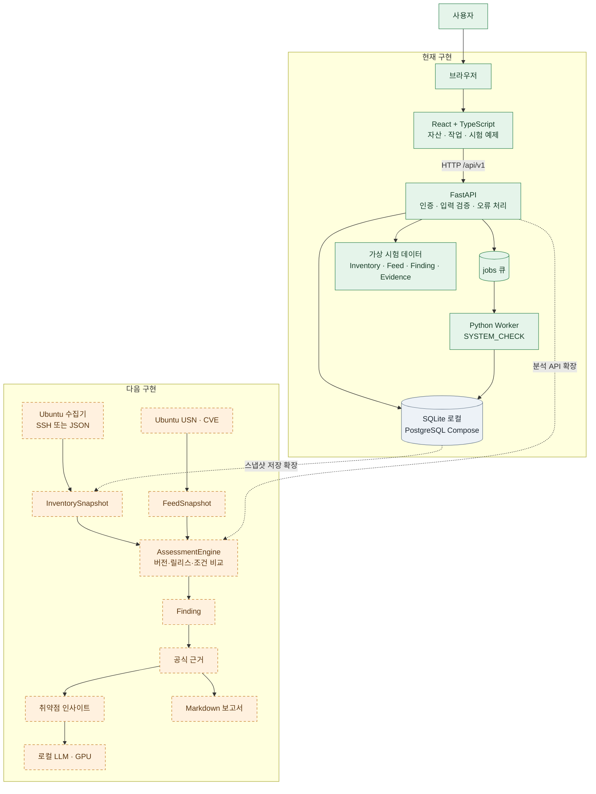
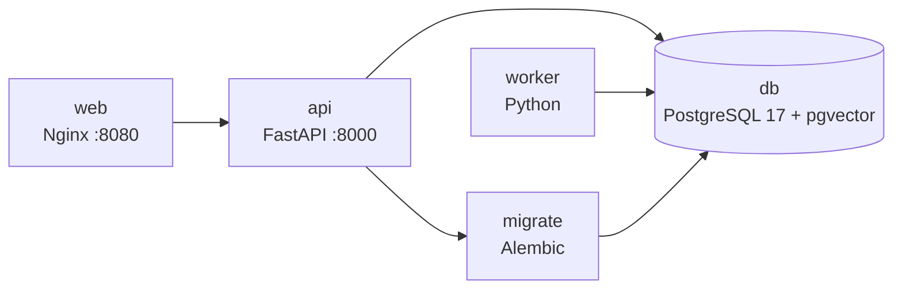
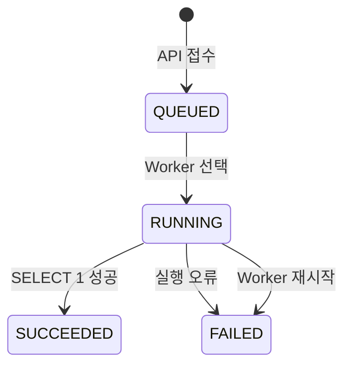
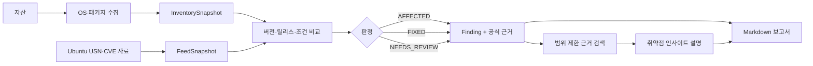

# 시스템 아키텍처

이 문서는 현재 저장소에서 실제로 실행되는 구조와 향후 사이버 위협 분석 기능을 연결할 위치를 설명합니다. 구현된 기능과 설계만 준비된 기능을 구분해 기록합니다.

## 현재 구성 한눈에 보기

현재 실행 경로는 다음 네 부분으로 구성됩니다.

```text
React 웹
  ↓ /api/v1
FastAPI API
  ↓
SQLite 또는 PostgreSQL
  ↑
Python Worker
```

현재 실제로 동작하는 흐름은 자산 등록, 작업 큐의 `SYSTEM_CHECK`, 가상 시험 예제 조회입니다. SSH 수집, 공식 CVE 자료 수집, 취약점 판정, RAG, LLM, 보고서 생성은 아직 연결되지 않았습니다.

## 시스템 구성



초록색은 현재 실행되는 구성, 회색은 저장소 인프라, 주황색 점선은 다음 구현 단계입니다.

## 실행 환경

### 로컬 개발

`scripts/dev.py`가 다음 프로세스를 준비하고 실행합니다.

| 프로세스 | 역할 | 기본 주소·저장소 |
| --- | --- | --- |
| FastAPI | HTTP API와 OpenAPI | `127.0.0.1:8000` |
| Python Worker | DB 큐의 작업 실행 | 별도 포트 없음 |
| Vite | React 개발 서버와 `/api` 프록시 | `127.0.0.1:5173` |
| SQLite | 자산·작업 저장 | `.data/dev.db` |

`make dev`는 API·Worker·Vite를 함께 실행합니다. `make dev-ui` 또는 `--no-worker`는 Worker를 생략하므로 접수한 작업은 `QUEUED` 상태로 남습니다. 종료 시 실행기가 시작한 하위 프로세스를 정리합니다.

### Docker Compose



Compose 서비스는 다음 순서로 준비됩니다.

| 서비스 | 역할 | 시작 조건 |
| --- | --- | --- |
| `db` | PostgreSQL과 `pgvector` 확장 | 없음 |
| `migrate` | Alembic 마이그레이션 적용 후 종료 | `db` healthy |
| `api` | 자산·작업 API 제공 | `migrate` 성공 |
| `worker` | DB 큐 조회와 작업 처리 | `migrate` 성공 |
| `web` | 정적 React 파일과 `/api` 프록시 | `api` healthy |

Compose에서는 웹만 호스트의 `127.0.0.1:8080`에 공개합니다. API와 DB는 Compose 내부 네트워크에서 통신합니다. `db-data` 볼륨은 `docker compose down` 뒤에도 유지됩니다. Compose 전체 기동은 별도 환경에서 검증해야 합니다.

## 백엔드 구성

| 경로 | 역할 | 현재 상태 |
| --- | --- | --- |
| `backend/api/main.py` | FastAPI 앱, health/readiness, 라우터와 공통 오류 처리 | 구현 |
| `backend/api/dependencies.py` | DB 세션과 개발용 Bearer 토큰 확인 | 구현 |
| `backend/api/routes/assets.py` | 자산 등록·조회·활성 상태 변경 | 구현 |
| `backend/api/routes/jobs.py` | `SYSTEM_CHECK` 접수와 작업 조회 | 구현 |
| `backend/api/routes/examples.py` | 가상 시험 예제 읽기 전용 API | 구현 |
| `backend/api/routes/findings.py` | 분석·판정 경로 | `501` 틀 |
| `backend/api/routes/questions.py` | 취약점 인사이트 요청 경로 | `501` 틀 |
| `backend/api/routes/reports.py` | 보고서 경로 | `501` 틀 |
| `backend/api/routes/sources.py` | 공식 자료 경로 | `501` 틀 |
| `backend/api/schemas/` | HTTP 입력·출력 검증 | 구현 |
| `backend/core/` | 설정, DB 연결, 오류·진단 | 구현 |
| `backend/models/tables.py` | 영속 테이블 `assets`, `jobs` | 구현 |
| `backend/models/contracts.py` | 수집·자료·판정·답변 도메인 계약 | 계약만 구현 |
| `backend/migrations/` | Alembic 변경 이력 | `0001` 구현 |
| `backend/worker/runner.py` | 큐 선택, 상태 변경, `SYSTEM_CHECK` 실행 | 부분 구현 |
| `backend/collectors/` | 서버 환경 수집기 확장 위치 | `Protocol`만 정의 |
| `backend/normalizers/` | 공식 자료 정규화 확장 위치 | `Protocol`만 정의 |
| `backend/assessment/` | 규칙 기반 판정 엔진 확장 위치 | `Protocol`만 정의 |
| `backend/retrieval/` | 분석 기준에 연결된 근거 검색 위치 | `Protocol`만 정의 |
| `backend/llm/` | 판정·근거 설명 생성 위치 | `Protocol`만 정의 |
| `backend/reports/` | Markdown 보고서 생성 위치 | 확장 위치 |

`Protocol`은 모듈 사이의 입력·출력 약속입니다. 선언만으로 SSH 접속, 외부 자료 요청, 판정 실행 또는 모델 호출이 수행되지는 않습니다.

## 프론트엔드 구성

`frontend/src/App.tsx`가 세션, 공통 레이아웃, 기능별 페이지를 조합합니다.

| 경로 | 역할 |
| --- | --- |
| `app/` | 해시 라우팅, 세션, 공통 레이아웃 |
| `api/` | Bearer 토큰 HTTP 클라이언트, 생성 TypeScript 타입 |
| `features/assets/` | 자산 목록·등록·활성 상태 변경 |
| `features/jobs/` | 작업 조회와 Worker 연결 확인 |
| `features/examples/` | 가상 입력·기대 판정·인용·JSON 표시 |
| `features/findings/` | 판정 결과 화면 틀 |
| `features/questions/` | 취약점 인사이트 화면 틀 |
| `features/reports/` | 보고서 화면 틀 |
| `shared/` | 연결 패널, 알림, 폴링·액션 훅, 표시 형식 |

화면 경로는 `#/assets`, `#/jobs`, `#/example`, `#/findings`, `#/questions`, `#/reports`입니다. API 연결 후 토큰과 HTTP 클라이언트는 브라우저 메모리에만 유지하고 새로고침하면 다시 연결해야 합니다.

## 데이터 저장

현재 실제 DB 테이블은 두 개입니다.

### `assets`

자산 이름, 주소, 예상 Ubuntu 릴리스, 노출 범위, 중요도, 담당자 표시명, 수집 방식, 활성 상태와 생성·수정 시각을 저장합니다. 현재 등록 API의 수집 방식은 `MANUAL`만 허용합니다. 주소를 저장해도 자동 접속하지 않습니다.

### `jobs`

작업 종류, 대상 자산 참조, 상태, 중복 방지 키, 시도 횟수, 결과, 오류 코드와 생성·시작·종료 시각을 저장합니다. 현재 작업 종류는 `SYSTEM_CHECK`만 성공적으로 처리합니다.

### 아직 DB에 만들지 않은 계약

`InventorySnapshot`, `FeedSnapshot`, `Finding`, `Answer`는 Pydantic 도메인 계약으로 검증되지만 현재 별도 테이블에 저장되지 않습니다. 실제 기능을 연결할 때 자산 스냅샷, 설치 패키지, 공식 문서 버전, 분석 실행, 판정, 문서 조각, 답변과 보고서 저장 구조를 추가합니다.

SQLite와 Compose PostgreSQL은 서로 다른 저장소입니다. 로컬에서 등록한 자산과 Compose에서 보이는 자산은 자동으로 동기화되지 않습니다. 시각은 UTC로 저장하고 화면은 KST로 표시합니다.

## 작업 처리



1. API는 `Idempotency-Key`로 기존 작업을 찾고, 새 키이면 `QUEUED` 작업을 생성합니다.
2. Worker는 하나의 작업을 선택해 `RUNNING`으로 변경하고 시도 횟수를 올립니다.
3. `SYSTEM_CHECK`는 DB 연결에서 `SELECT 1`을 수행하고 결과와 종료 시각을 저장합니다.
4. 지원하지 않는 작업은 `UNSUPPORTED_JOB_TYPE`, 실행 예외는 `JOB_EXECUTION_FAILED`로 실패 처리합니다.
5. Worker 재시작 때 남아 있는 `RUNNING` 작업은 `WORKER_RESTARTED`로 실패 처리합니다.

PostgreSQL Worker는 advisory lock으로 중복 실행을 막습니다. SQLite에는 같은 잠금이 없으므로 로컬에서는 Worker 하나만 실행해야 합니다. `PARTIAL`, 자동 재시도, 취소, 예약 실행, 작업별 시간 제한과 heartbeat는 아직 사용하지 않습니다.

## 목표 분석 파이프라인



이 파이프라인은 목표 구조입니다. 현재는 `examples/data/`의 가상 JSON과 기대 결과가 이 연결을 검증하는 역할을 하며 실제 수집·판정·검색·설명은 수행하지 않습니다.

## 경계와 보안 원칙

- 운영체제 변경, 자동 패치, 서비스 재시작, 임의 명령 실행은 기능 범위에 포함하지 않습니다.
- 실제 수집은 등록된 대상, 호스트 키, 고정된 읽기 전용 명령과 시간 제한을 전제로 합니다.
- 입력 문서와 모델 출력은 실행 명령으로 사용하지 않습니다.
- 확정 판정은 공식 조건과 설치 버전이 확인된 경우에만 생성합니다.
- 수집이 부분 실패하거나 출처가 불명확하면 `NEEDS_REVIEW` 또는 별도 처리 상태로 보존합니다.
- 모델 장애가 발생해도 저장된 판정과 공식 근거 조회는 유지하도록 분리합니다.
- 현재 인증은 개발용 공통 토큰이며 운영 계정·세션·자산별 권한은 구현되지 않았습니다.

## 문서와 검증의 기준

- 실제 경로와 HTTP 응답은 코드와 생성된 `docs/openapi.json`을 기준으로 합니다.
- 기능별 목표와 구현 상태는 [기능 명세](specification.md)를 기준으로 합니다.
- 단계별 작업 우선순위는 [개발 예정 기능](roadmap.md)을 기준으로 합니다.
- 시험 예제는 실제 분석 결과와 분리된 가상 자료입니다.
- Compose, PostgreSQL, 실제 Ubuntu 수집, 공식 CVE 정확성, GPU 모델과 RAG는 별도 검증 전까지 미검증입니다.
