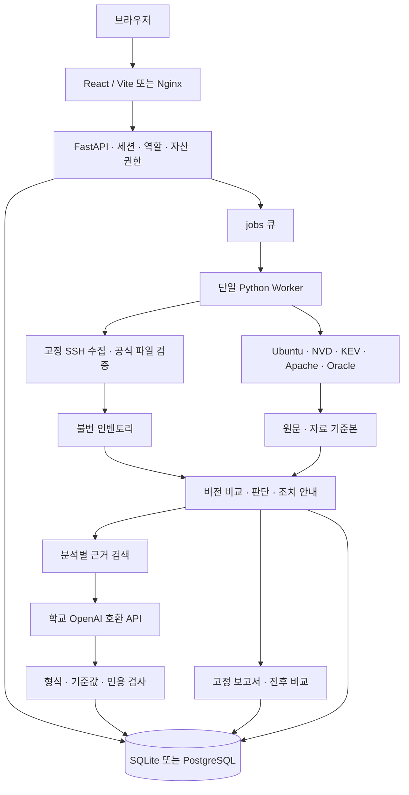

# 시스템 아키텍처

## 실행 구성

로컬은 API `127.0.0.1:8000`, Vite `127.0.0.1:5173`, SQLite를 사용합니다. Compose는 PostgreSQL 17·마이그레이션·API·Worker·Nginx로 구성하며 웹만 호스트 루프백에 노출합니다. 인증 프록시는 원래 Host와 포트를 보존합니다.

## 모듈과 저장소

| 모듈                                 | 역할과 주요 테이블                                                                                |
| ------------------------------------ | ------------------------------------------------------------------------------------------------- |
| `backend/auth`, `api/routes/auth.py` | `users`, `login_sessions`, `asset_grants`, `login_throttles`, `audit_events`                      |
| `backend/collectors`                 | JSON·CSV 입력, SSH 고정 조회; `ssh_profiles`, `collection_runs`, `inventory_snapshots`            |
| `backend/verification`               | 서명·패키지·설치 파일 대조; `verification_runs`, 새 인벤토리                                      |
| `backend/sources`                    | 5개 출처별 수집·정규화; `source_runs`, `security_snapshots`, `source_documents`, `source_records` |
| `backend/assessment`                 | 고정 입력, Debian 전체 버전 비교, 조건 제한, 대응 안내; `analyses`, `findings`                    |
| `backend/comparison`                 | 같은 보안 기준본으로 두 인벤토리를 재평가; `comparisons`                                          |
| `backend/llm`                        | 한 CVE의 설명·인용·검증; `explanations`                                                           |
| `backend/retrieval`                  | 분석 범위의 TF-IDF 검색·학교 API 질문; `text_chunks`, `questions`, `question_assets`              |
| `backend/reports`                    | 입력 고정·미리보기·Markdown·파일 해시; `reports`                                                  |
| `backend/worker`                     | `jobs` 큐 실행, 접근 권한 재검사, 종료·실패 감사 기록                                             |

마이그레이션은 `0001`~`0011`입니다. 최초 계약의 Protocol은 확장 경계를 표현하며, 실행 코드·HTTP 스키마와 구분합니다. PostgreSQL 이미지에는 pgvector가 포함되지만 현재 검색은 **로컬 희소 TF-IDF 벡터**이며 pgvector·외부 임베딩 서비스를 사용하지 않습니다.

## 접근 제어

`AUTH_MODE=accounts`에서 불투명 세션 쿠키의 해시·만료 시각을 DB에 저장합니다. 비밀번호는 scrypt로 해시합니다. HttpOnly/SameSite 쿠키, 변경 요청 CSRF 토큰·Origin 검사, 로그인 속도 제한을 적용합니다. 관리자는 전체 자산, 담당자는 부여된 자산의 작업 실행, 조회자는 부여된 자산의 조회만 허용합니다.

요청별 DB 세션의 principal을 사용해 ORM 조회·집계·쓰기 범위를 제한합니다. 여러 자산의 질문은 **모든 자산**의 접근 권한이 있어야 목록·상세·작업 조회가 가능합니다. Worker도 작업 시작 시 계정·역할·권한을 다시 확인합니다. 공식 보안 자료는 전체 계정이 공유하는 공개 자료입니다. 자료 갱신·계정·권한·감사 조회는 관리자에게 제한합니다.

## 불변 근거

수집·검증은 새 인벤토리를 생성하고 과거 기록을 바꾸지 않습니다. 분석은 인벤토리, 출처 기준본, 규칙 버전을 고정합니다. 비교는 기준 분석의 보안 자료로 양쪽 인벤토리를 재평가합니다. 질문은 선택 분석과 검색 조각·인용·입력 해시를 고정합니다. 보고서는 접수 당시 분석·설명·공식 파일 검증 근거를 고정해 저장합니다.

원문은 UTF-8 텍스트로 저장하고 HTML·모델 출력은 실행하지 않습니다. 질문 조각의 문자 위치는 정규화된 보안 레코드 기준이며, 원문은 문서 ID·주소·해시로 연결합니다.

## 작업과 장애

`SYSTEM_CHECK`, `SOURCE_SYNC`, `SSH_COLLECTION`, `VERIFICATION`, `ASSESSMENT`, `COMPARISON`, `EXPLANATION`, `QUESTION`, `REPORT`를 처리합니다. 상태는 `QUEUED → RUNNING → SUCCEEDED / PARTIAL / FAILED`입니다. SSH 참고 정보 실패·파일 일부 확인 불가는 PARTIAL로 구분할 수 있습니다.

동일 Idempotency-Key는 같은 작업을 반환하며 실패 작업을 자동 재실행하지 않습니다. Worker 시작 시 남은 RUNNING 작업은 실패 처리하고 활성 슬롯을 해제합니다. SQLite는 OS 파일 잠금, PostgreSQL은 advisory lock으로 Worker 중복 실행을 막습니다. 자동 예약·분산 처리·자동 재시도·취소는 현 범위에 포함하지 않습니다.

모든 네트워크 어댑터는 대상·응답 크기·시간을 제한합니다. 모델 장애가 분석 조회를 막지 않습니다. 로그는 예외 유형·코드 위치·요청 ID를 기록하고 입력값·비밀키·모델 응답 원문은 출력하지 않습니다. 운영 감사에는 자산 수정, 로그인·권한 변경, 작업 접수·종료와 접근 거절을 기록합니다.

## 판단 경계

Ubuntu 22.04·24.04의 Apache2·MySQL 패키지 판단을 제공합니다. 수정 전 버전의 모듈·설정·실행 조건을 자동 확정하지 않으며, 공식 파일 일치도 설정·실행 메모리·과거 설치 경로의 증명으로 사용하지 않습니다. 실제 인수 범위와 남은 환경 검증은 [검증 기록](verification.md)을 따릅니다.
